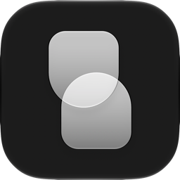

# Stopwatch

A tiny macOS menu bar stopwatch, with an optional floating stopwatch on top of everything.

- Click to start and stop, double-click to reset; ⌥+click to resume or start from zero.
- Global shortcuts: ⌥\ acts like a click, ⌥⇧\ like a ⌥+click; a quick double press resets.
- Timer from 5 seconds to an hour: when time's up the stopwatch turns red and can play a sound.
- Floating stopwatch that snaps to the screen edges. Right-click it to change its style, size, font and color.

## Install

Download the `.dmg` from [Releases](../../releases), open it and drag **Stopwatch** to **Applications**.

The app isn't notarized, so macOS blocks the first launch. Click **Open Anyway** in
**System Settings → Privacy & Security**, or run:

```sh
xattr -dr com.apple.quarantine /Applications/Stopwatch.app
```

Requires macOS 12 or later.

## Build

```sh
scripts/build-app.sh   # build/Stopwatch.app
scripts/release.sh     # build/Stopwatch-<version>.dmg (universal)
```

To publish a release, set the version in `Resources/Info.plist`, then push a matching tag (`git tag v1.0 && git push origin v1.0`).
GitHub Actions builds the disk image and attaches it to the release.

## License

Copyright © 2026 Iftach Dafni. All rights reserved.
